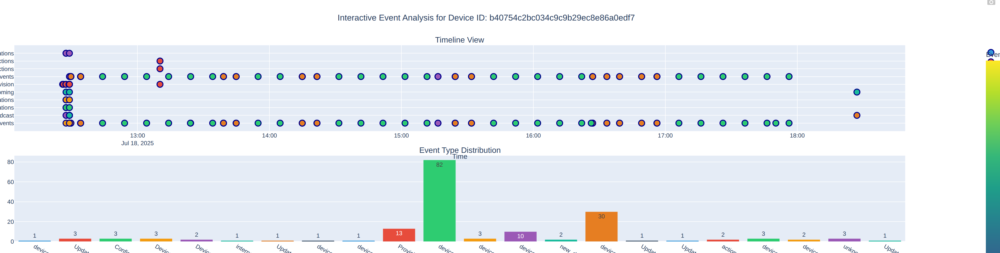
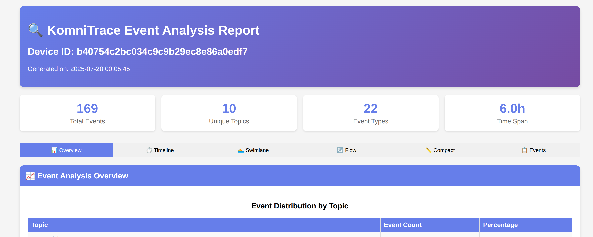

# KomniTrace

Traces every Kafka record that mentions a device (or any other identifier) across all the topics of a Kafka cluster running in Kubernetes, and renders the result as JSON plus HTML/PNG reports.

It is designed to be run against **production** clusters: reads are window-scoped, bounded and group-less, and the tool checks the target pod before launching anything heavy.

- Internals, in-pod protocol and coverage verdicts: [Documentation/ARCHITECTURE.md](Documentation/ARCHITECTURE.md)
- What changed in 2.0 and migration notes: [CHANGELOG.md](CHANGELOG.md)

## How it works

1. **Probe** the target pod once: which Kafka CLI tools exist, whether `awk`/`grep`/`timeout` are available, whether the pod is a running broker, and its cgroup memory working set.
2. **Resolve offsets for all topics** with 2–4 JVM launches in total (earliest, latest, window start via `offsetsForTimes`, window end). Older versions launched 2 JVMs per topic.
3. **Plan**: for every partition, read only `[offset(window start), offset(window end))`. The plan (topics, partitions, message counts) is logged and written to `plan_<device>.json`. Plans above `--max-total-messages` are refused unless you pass `--yes`.
4. **Scan** each partition with an exact consumer: `--partition/--offset/--max-messages`, an inactivity guard (`--timeout`) and a hard wall-clock cap (`--partition-timeout`) enforced **inside the pod**. There are no consumer groups, rebalances, commits or live tailing, and every in-pod process exits by itself even if the client dies.
5. **Filter inside the pod** (`awk`, falling back to `grep -F`), so only matching records cross `kubectl exec`/SSH. The filter also reports the last offset read per partition.
6. **Coverage**: `coverage_<device>.json` records expected vs consumed messages per partition, plus its status (`complete`, `incomplete`, `hard_timeout`, `error`, `cancelled`). It also flags partitions where retention already deleted part of the window, or where `--max-messages` capped the read. Gaps are reported, never silent.

### Production safety

| Risk | Mitigation |
|------|-----------|
| Tool JVMs OOM-kill the broker (`kubectl exec` into a broker shares its memory cgroup) | Small heap (`--tool-heap`, default 256m), SerialGC, C1 only. Parallelism is capped by the pod's memory working set, and the run is refused when headroom is too low. Broker pods are limited to 2 concurrent JVMs. Use `--kafka-pod` with a client/toolbox pod whenever possible. |
| JMX / javaagent port clashes (`Address already in use`) | `JMX_PORT` is cleared and `-javaagent:` is stripped from `KAFKA_OPTS` for tool JVMs |
| Reading whole topics from the beginning (cold segments evict page cache, broker I/O spikes) | The time window is converted to start offsets; only the window is read. `--max-messages` reads the newest N per partition. |
| Consumer-group churn / rebalances | Assign mode, `enable.auto.commit=false`, no group |
| Orphan consumers in the pod after Ctrl-C or network loss | Every read is bounded (`--max-messages`, `--timeout-ms`, `timeout`) |
| Unidentifiable load on the brokers | `client.id=komnitrace` (configurable), so operators can see it and apply quotas |
| CPU contention in the pod | Tool JVMs run under `nice -n 10` |

## Requirements

- Python 3.8+ (standard library only for collection)
- `kubectl` access to the cluster, either locally or on an SSH host
- Kafka CLI tools inside the target pod (Apache Kafka 3.x/4.x scripts; for < 3.0 it falls back to `kafka-topics` + `GetOffsetShell`)
- Optional: `matplotlib` (PNG graphs + HTML report), `plotly` (interactive timeline), `orjson` (faster JSON), `sshpass` (password SSH)

## Usage

```bash
# Last 8 days (default), all topics, local kubectl
python3 KomniTrace.py -n my-namespace -d b40754c2bc034c9c9b29ec8e86a0edf7

# kubectl on a remote master: one multiplexed SSH connection (password works with parallelism)
SSHPASS='secret' python3 KomniTrace.py -n my-namespace -d b40754c2bc034c9c9b29ec8e86a0edf7 \
  --ssh-host 10.11.12.13 --ssh-user root \
  --kafka-pod pod/kafka-broker-0 --kafka-container kafka --kafka-broker kafka:9092

# See exactly what would be read, without consuming anything
python3 KomniTrace.py -n my-namespace -d 12345 --dry-run

# Exact window, specific topics, also match the account id and an encrypted id
python3 KomniTrace.py -n my-namespace -d 12345 \
  --since 2025-09-10T08:00 --until 2025-09-10T12:00 \
  --topics as-provision-topic device-events-topic --match ACCOUNT-42 --match 'P5P4HFT4DH...'

# Run the CLI tools from a client pod instead of a broker (recommended in production)
python3 KomniTrace.py -n my-namespace -d 12345 --kafka-pod deploy/kafka-client

# SASL/SSL clusters: properties file inside the pod
python3 KomniTrace.py -n my-namespace -d 12345 --kafka-client-config /opt/kafka/config/client.properties

# Rebuild the report from a previous run
python3 KomniTrace.py --report-only --events-json trace_output/events_12345.json -d 12345
```

### What is matched

A record matches when its value, key or headers contain any search term (case-insensitive):

- the device id;
- the device id in the other UUID spelling: a 32-hex id also matches the dashed form, and vice versa;
- every `--match` term (account id, MAC, IP, encrypted/hashed id...);
- the JSON-escaped `\/` variant of any term that contains `/`.

Services that only carry an encrypted or hashed device id cannot be found by the plain id. Add that value with `--match`.

## Options

### Search
| Option | Default | Description |
|--------|---------|-------------|
| `--device-id`, `-d` | required | Identifier to trace |
| `--match TERM` | | Extra term to match (repeatable) |
| `--max-age`, `-a` | `192` | Window: last N hours (`0` = all retained data) |
| `--since` / `--until` | | Absolute window (ISO datetime); `--since` overrides `--max-age` |

### Kafka / Kubernetes
| Option | Default | Description |
|--------|---------|-------------|
| `--namespace`, `-n` | required | Namespace of the target pod |
| `--kafka-pod` | `deployment/kafka` | Pod/deployment where the CLI tools run |
| `--kafka-container` | | Container inside the pod |
| `--kafka-broker`, `-b` | `kafka:9092` | Bootstrap server as seen from the pod |
| `--kafka-bin-dir` | auto | Kafka scripts dir inside the pod (`/opt/kafka/bin`, `/opt/bitnami/kafka/bin`, ... are auto-detected) |
| `--kafka-client-config` | | Client properties inside the pod (SASL/SSL) |
| `--kubectl` | `kubectl` | e.g. `"k3s kubectl"`, `oc` |
| `--context` | | kubeconfig context |
| `--topics` | | Explicit topic list |
| `--topic-filter`, `-f` / `--topic-regex` | | Substring / regex topic selection |
| `--exclude-regex` | `^_` | Topics to skip (internal topics) |

### Load and safety
| Option | Default | Description |
|--------|---------|-------------|
| `--max-parallel`, `-p` | `4` | Concurrent `kubectl exec` sessions (one tool JVM each); auto-reduced by the guards |
| `--timeout` | `15` | Seconds without records before a partition read stops |
| `--partition-timeout` | `900` | Hard cap per partition, enforced in the pod |
| `--max-messages`, `-m` | | Per partition, read only the newest N messages of the window |
| `--max-total-messages` | `20000000` | Refuse larger plans unless `--yes` |
| `--partitions-per-exec` | `16` | Partitions read sequentially per `kubectl exec` |
| `--tool-heap` | `256m` | Max heap of the tool JVMs |
| `--client-id` | `komnitrace` | Kafka `client.id` |
| `--no-remote-filter` | | Stream all records and filter locally |
| `--dry-run` | | Print the plan only |
| `--yes`, `-y` | | Accept plans above the budget |
| `--unsafe` | | Disable the memory/broker parallelism guards |

### SSH
| Option | Description |
|--------|-------------|
| `--ssh-host`, `--ssh-user` | Host where `kubectl` runs |
| `--ssh-password` | Password. Prefer the `SSHPASS` env var: command-line arguments are visible in `ps`. |
| `--ssh-key` | Private key |
| `--ssh-setup-keys` | Generate and install a dedicated ed25519 key (opt-in; it is reused automatically on later runs) |
| `--ssh-no-key-setup` | Do not look for/reuse the dedicated key |
| `--ssh-clean-keys` | Remove the dedicated key and the legacy `~/.ssh/config` block written by older versions |
| `--ssh-insecure` | Skip host key verification (lab hosts that get reinstalled). The default is `accept-new`. |

All commands share one SSH master connection (`ControlMaster`). Authentication happens once, so password auth works with any parallelism, up to 8 sessions (sshd `MaxSessions`).

### Output
| Option | Default | Description |
|--------|---------|-------------|
| `--output-dir`, `-o` | `./trace_output` | Output directory (the log goes there too) |
| `--no-reports` (`--no-graphs`) | | Only save JSON |
| `--verbose`, `-v` | | Debug logging on the console |

## Output files

- `events_<device>.json`: matching records (`timestamp`, `topic`, `partition`, `offset`, `key`, `headers`, `event_type`, `message`, `raw_data`)
- `coverage_<device>.json`: per-partition expected vs consumed, last offset read, status, notes
- `plan_<device>.json`: the scan plan
- `report_<device>.html`, `timeline_/swimlane_/flow_/compact_<device>.png`, `interactive_timeline_<device>.html`
- `komni_trace.log`: full debug log

## Troubleshooting

- **`Pod has only N MiB memory headroom`**: the target pod (usually a broker) cannot afford another JVM. Point `--kafka-pod` to a client pod, or lower `--tool-heap`.
- **`incomplete` partitions in coverage**: the broker did not deliver records for `--timeout` seconds. Raise `--timeout`; the note shows the last offset reached.
- **`window older than retention`**: part of the requested window was already deleted by Kafka retention. Those events no longer exist.
- **No events but the device exists**: the service may log a different id (account, encrypted id). Add it with `--match`.
- **Host key changed**: fix `~/.ssh/known_hosts`, or use `--ssh-insecure` on lab hosts.

## Screenshots





## License

MIT, see [LICENSE](LICENSE).
